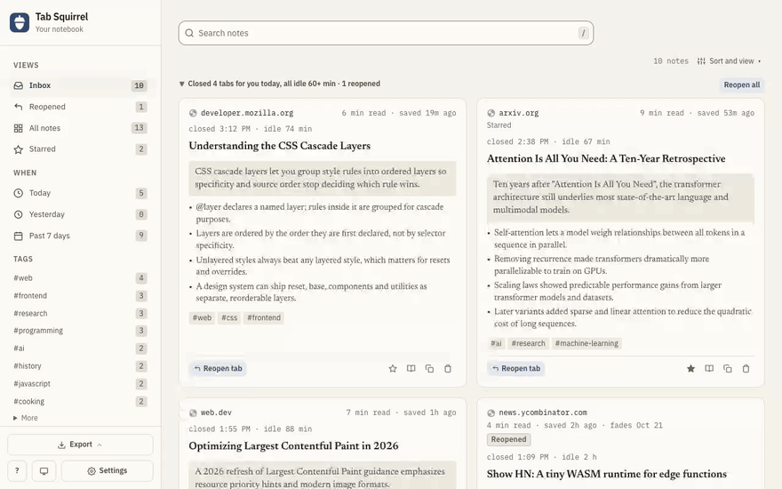
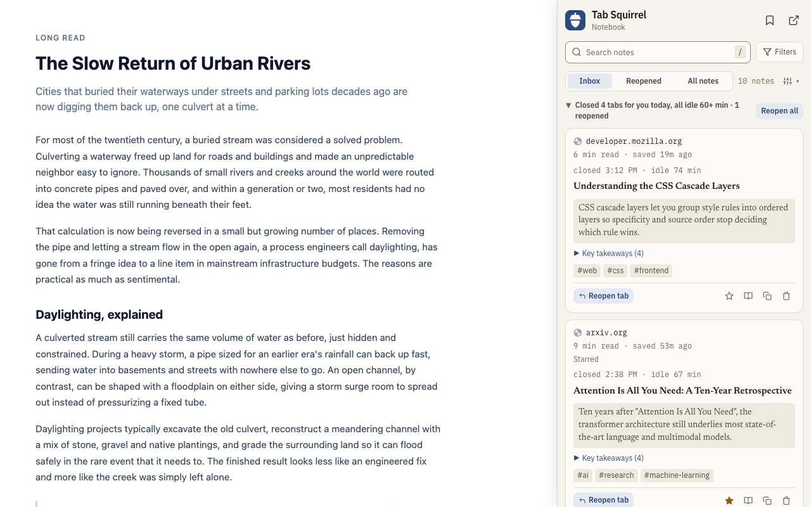
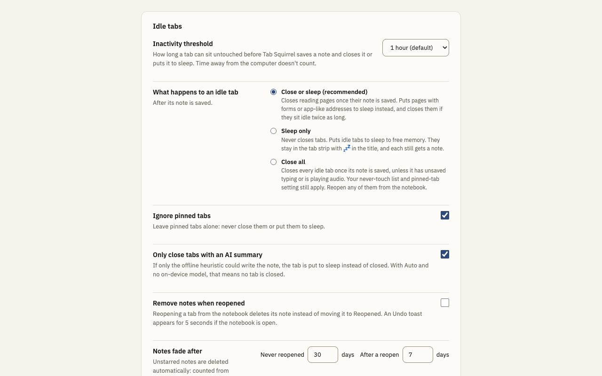
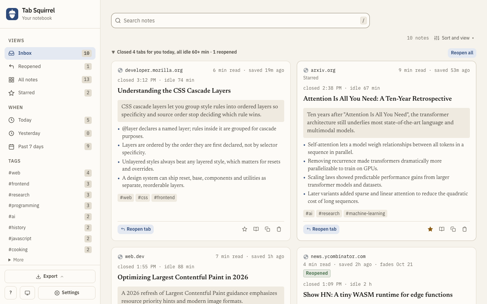
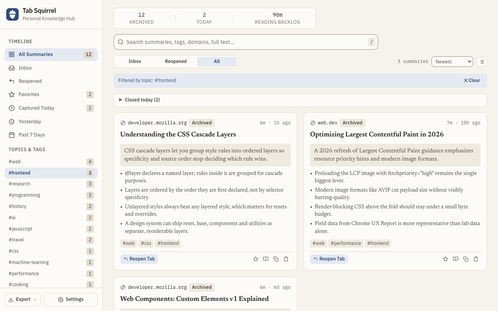
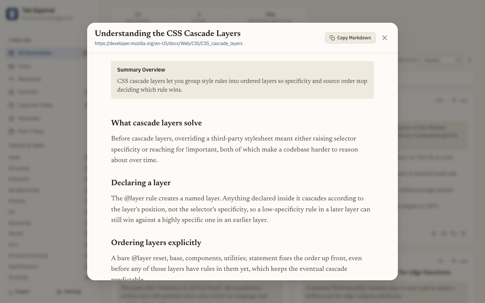
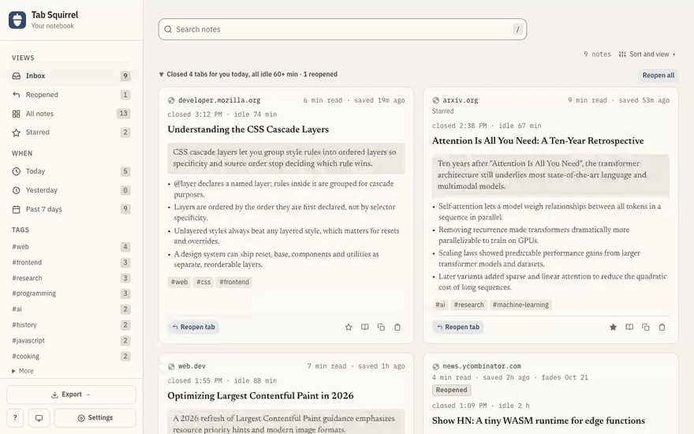

# Tab Squirrel

**Close the tabs you were never going to read, and keep what was in them.**


Tab Squirrel is a Chrome extension that watches your background tabs. When one has sat untouched for a set duration (default: 1 hour), Tab Squirrel reads the article text, writes a short summary, saves it to a searchable local notebook, and then closes the tab or puts it to sleep. Anything it closes can be reopened with one click. Nothing leaves your machine unless you choose Gemini or a server of your own.



## Why I built it

Much like a squirrel hoarding nuts for winter, I hoard tabs. I open a tab because some information there might be useful. I get distracted and see another tab, and another one, and another one, and I keep them all open because I don't want to lose information. Now I have FOMO for closing them, but now there are too many tabs, and now I can't read the system, and everything is kind of overwhelming. And, much like a squirrel hoarding nuts for the winter, I forget why I even opened the tabs in the first place.  

Tab hoarding is a working-memory problem. Every open tab is a thought you have not finished with, so closing it feels like losing it, and the bar fills up with favicon slivers. Tab suspenders like The Great Suspender and Chrome's memory saver free the RAM but leave the clutter, and neither leaves any record of what you had open.

The bet behind Tab Squirrel is that most of those tabs are worth a paragraph, not a slot in your tab strip. If the extension can reliably capture the gist, closing the tab stops being a loss. Most of the engineering effort went into making that "reliably" true: knowing when a page is safe to touch, and getting clean text out of it.

Open tabs keep an open loop in the mind and visual clutter in the browser, and that adds passive stress in the same way a messy room would. This is an attempt to get around that in a way that doesn't ask much of the user.

## How it works

1. **Wait for real inactivity.** A tab becomes eligible after the configured threshold (default 60 minutes). Time you spend idle, locked, or asleep does not count.
2. **Check the tab is safe to touch.** Unsaved typing, rich text editors, playing audio, and pinned tabs are left alone. Details below.
3. **Extract the article.** An in-tab extractor walks the DOM with CSS-selector heuristics and strips navigation, headers, footers, sidebars, ads, and cookie banners. Output is clean text, metadata, and a reading-time estimate.
4. **Summarize.** A one-sentence TL;DR, three to five bullet takeaways, and topic tags. Written by Chrome's on-device model, a local OpenAI-compatible server, or Gemini with your key. Falls back to an offline heuristic when no AI tier is available.
5. **Close or sleep.** In the default Close or sleep mode, plain reading pages are closed and interactive pages are put to sleep. Sleeping tabs that stay untouched are closed at twice the threshold. By default a tab is closed only when an AI model wrote its summary; otherwise it is put to sleep, so it stays in the tab strip.
6. **File it.** Every capture goes into a local IndexedDB notebook with full-text search and one-click restore. It opens as a Chrome side panel or as a full page in a tab.

Closed tabs collect in a **Closed today** section at the top of the notebook's feed, each note shown once. There are no per-tab notifications.



*The notebook at side-panel width. This image is a composite: Playwright cannot capture Chrome's own side panel, so the script renders the same page at panel width beside a sample article.*

## Features

### Modes

Close or sleep is the default. Two other modes are available under Settings, in **What happens to an idle tab**:

- **Close or sleep (recommended).** At the threshold, closes plain reading pages (no forms, editors, dialogs, or stateful URLs like checkouts) and puts everything else to sleep with `chrome.tabs.discard()`. A sleeping tab keeps its place in the tab strip with a `💤` prefix on its title and its memory freed. At twice the threshold, sleeping tabs you still have not touched are closed. Their summary was saved when they were put to sleep.
- **Sleep only.** Never closes. Puts idle tabs to sleep to free memory.
- **Close all.** Closes every idle tab unless it has unsaved typing. Never-touch sites, pinned tabs, audio and the AI-summary rule still apply.

**Only close tabs with an AI summary** is on by default. With only the offline heuristic summary available, the tab is put to sleep instead of closed. With Auto and no downloaded on-device model, that means no tab is closed until you pick a summarizer.



### Safety checks

No heuristic is infallible, but before touching a tab Tab Squirrel checks for:

- **Unsaved input.** Standard `<input>`, `<textarea>`, and `<select>` elements, including inside nested Shadow DOM trees.
- **Rich text editors.** `[role="textbox"]`, `[contenteditable]`, ProseMirror (Google Docs, Notion-style editors), Quill, Draft.js, Monaco (VS Code Web), CodeMirror, and Ace.
- **Media.** Tabs that are audible (video calls, podcasts, music) are always spared.
- **Pinned tabs.** Never touched by default.
- **Never-touch sites.** A listed domain covers its subdomains, so `google.com` covers `docs.google.com`. Defaults include Gmail, Google Docs, Drive, and Calendar, GitHub, GitLab, Slack, Teams, YouTube, Spotify, and Netflix.
- **Always-close sites.** The mirror of the never-touch list: domains that are closed once summarized even when the safety checks would only put them to sleep. Set either list from Settings or by right-clicking a tab.
- **Last-moment re-check.** After summarizing, Tab Squirrel confirms you have not switched to the tab or started audio in it before saving or closing anything.

The archive record is fully written before a tab is closed or put to sleep, so an interrupted service worker cannot lose it. If Chrome refuses to close or put a tab to sleep, the note is kept as Saved with the reason recorded.

### Summarization tiers

Pick one under **Summaries › Provider** in Settings.

| Tier | Engine | Where it runs | Notes |
| :--- | :--- | :--- | :--- |
| 0 | Heuristics | Offline | Lead-sentence extraction. No dependencies, no tags. |
| 1 | Chrome Prompt API | On device | Gemini Nano built into Chrome (`LanguageModel`), used only when already downloaded. This is what **Auto** uses. |
| 2 | Gemini Flash | Cloud, your key | Key stored locally in `chrome.storage.local`. |
| 3 | Local / OpenAI-compatible server | Your server | Any `/v1/chat/completions` endpoint: Ollama, LM Studio, oMLX, llama.cpp, vLLM. Set URL, model, and optional key in Settings. **Test connection** grants access and lists models. Responses stream, with a 2-minute cap. Ollama may need `OLLAMA_ORIGINS=chrome-extension://*`. |

If the chosen tier is unavailable, errors, or times out (20 seconds for cloud and on-device, 2 minutes for local servers), the summary falls back to Tier 0, and the tab is put to sleep rather than closed.

### The notebook

The side panel and the full view are one page (`src/app/`), so every feature works in both. At side-panel width it is a single column of cards with a **Filters** drawer. In a wide tab it is a persistent sidebar and a multi-column grid. The side panel adds **Save current tab** (the bookmark icon) and **Open full view**, and closes itself when you open the full view.



- **Search** covers titles, URLs, summaries, tags, and the saved page text, with matches highlighted on the cards.
- **Inbox, Reopened, and fading.** The notebook opens on the Inbox: captures you have not dealt with. A note leaves the Inbox when you read it, star it or reopen its tab; unstarring does not put it back. Reopening a tab also moves its note to Reopened, still searchable (unless Remove notes when reopened is on, which deletes it instead when you reopen it from the notebook; switching to a sleeping tab never deletes). Unstarred notes delete themselves 30 days after capture if never reopened, or 7 days after the last reopen. Both are configurable, and 0 means never. Within 3 days of fading a note shows a `Fading soon · 2d left` chip, and within a week a quiet `fades Oct 30` date. Star a note to keep it forever. Capturing the same page again puts an unstarred note back in the Inbox with a fresh clock; a starred note stays filed.
- **Undo.** Deleting a card shows a toast with a 5-second Undo button. Deleted notes are purged an hour later.
- **Sorting.** Newest, oldest, quick reads first, deep dives first, title, domain, and expiring soon.
- **Filters.** By tag, domain, starred, or time (today, yesterday, past 7 days). Clicking a tag on a card filters by it.
- **Status badges.** Sleeping (put to sleep, still in the tab strip), Reopened, and Saved (note kept, tab still open). Closed notes carry no badge. A note whose summary came from the offline heuristic says "offline summary" in quiet text.
- **Reader view.** The saved page text in a `<dialog>` with reading typography. Escape or a click outside closes it.
- **Light and dark themes.** System, Light or Dark, from the notebook footer or Settings.
- **Shortcut list.** Press `?` in the notebook.
- **Density.** Comfortable cards or a compact list. The choice is remembered.
- **In-place restore.** Reopening a note's tab first checks whether that URL is already open in any window, and switches to it rather than opening a duplicate.

| Filtered by tag | Reader view |
| :---: | :---: |
|  |  |

### Export

- **Obsidian.** A `.zip` with one `.md` note per tab. YAML frontmatter (`title`, `url`, `captured_at`, `reading_time_minutes`, `tags`) that Obsidian reads as properties and tags.
- **Markdown.** GitHub-flavored, for Notion, Logseq, or a plain repository.
- **JSON.** Every record, with summaries and extracted text. Re-import it from Settings with **Import JSON**.

### Keyboard

| Shortcut | Action |
| :--- | :--- |
| `Cmd+Shift+S` / `Ctrl+Shift+S` | Open the side panel |
| `Cmd+Shift+E` / `Ctrl+Shift+E` | Summarize and save the active tab now. The tab stays open. |
| `j` / `↓`, `k` / `↑` | Next / previous card |
| `Enter` | Reopen the selected tab |
| `o` | Read the selected note |
| `s` | Star or unstar it |
| `Delete` / `Backspace` | Delete it |
| `u` | Undo, while the Undo bar shows |
| `/` | Focus search |
| `Escape` | Leave search (press again to clear it), or close a dialog |
| `?` | List the shortcuts |



## Install

Tab Squirrel is not on the Chrome Web Store yet. Load it unpacked:

```bash
git clone https://github.com/AndroidLemon/TabSquirrel.git
```

1. Open `chrome://extensions/` and turn on **Developer mode**.
2. Click **Load unpacked** and select the `TabSquirrel` directory.
3. Click the Tab Squirrel icon (or press `Cmd+Shift+S`) to open the side panel, then click **Allow all sites** on the banner so Tab Squirrel can read article text. You can also do this later from Settings.
4. Optional: under **Settings › Summaries › Provider**, pick a summarizer. Chrome's on-device model is used automatically if it is downloaded.

To build an upload-ready zip containing only `manifest.json`, `src/`, and `LICENSE`:

```bash
npm run package   # → dist/tab-squirrel-<version>.zip
```

## Settings

Right-click the extension icon and choose **Options**, or click **Settings** in the notebook.

| Setting | Default | What it does |
| :--- | :--- | :--- |
| Theme | System | System, Light or Dark; also in the notebook footer. |
| What happens to an idle tab | Close or sleep | Close or sleep, Sleep only, or Close all. See above. |
| Only close tabs with an AI summary | On | Otherwise the tab is put to sleep. |
| Inactivity threshold | 60 min | 15m, 30m, 1h, 2h, 4h, or 24h. Time away from the computer does not count. |
| Ignore pinned tabs | On | Pinned tabs are never put to sleep or closed. |
| Never touch these sites / Always close these sites | Default list / empty | Never touch, or always close once summarized. Subdomains included. |
| Remove notes when reopened | Off | Reopening a note from the notebook deletes it instead of moving it to Reopened; switching to a sleeping tab in the tab strip does not. An Undo toast is offered for 5 seconds if the notebook is open. |
| Notes fade after | 30 / 7 days | Days after capture (never reopened) / after the last reopen. 0 = never. |
| Summaries › Provider | Auto | On-device model when downloaded, else heuristics. Or Gemini, or a local server. |

## Privacy

The full policy is in [PRIVACY.md](PRIVACY.md). The short version:

- All summaries, text, metadata, and tags live in your browser's IndexedDB (`TabSquirrelDB`).
- No analytics, no trackers, no external logging.
- Page access is an optional permission you grant with a click, not at install. A local server's address is granted the same way, via **Test Connection**.
- Favicons come from Chrome's own local favicon cache, never from a page-supplied URL or a third-party service.
- URLs are validated to `http:` and `https:` before use, which blocks `javascript:` injection.
- API keys stay in this browser's `chrome.storage.local`. Not synced, and sent only to the provider they belong to. Like all extension storage, unencrypted on disk.
- With the default Auto provider, Tab Squirrel makes no network requests at all. Page text leaves the browser only for the summarizer you choose.

## Design decisions

The hard part of this project was not the UI. It was deciding when a page is safe to close and getting usable text out of arbitrary sites. The reasoning is written down:

- [`docs/decisions/`](docs/decisions/) holds the architecture decision records. They are immutable. A changed mind gets a new record that supersedes the old one.
- [`docs/EXTRACTION_PLAN.md`](docs/EXTRACTION_PLAN.md) is the scoped plan for the text extractor, with the measurements that motivated each step.
- [`docs/FOLLOWUPS.md`](docs/FOLLOWUPS.md) lists everything deferred on purpose, with the trigger that would make it worth doing.
- [`logs/`](logs/) holds the measurement baselines and adversarial review transcripts the decisions cite.
- [`docs/CHROMEWEBSTORE.md`](docs/CHROMEWEBSTORE.md) is the draft store listing and privacy disclosure.

## Codebase

```
manifest.json                  Manifest V3: permissions, global shortcuts
src/
  background/service-worker.js Inactivity tracking (idle/sleep aware), sweeps, close/suspend engine, fading
  content/in-tab-extractor.js  Article extraction, shadow DOM and dirty-form guards, title badge
  ai/summarizer.js             Tiers 0-3
  storage/db.js                IndexedDB: tombstoned soft deletes, separate text store, sorting, fading, settings
  shared/closure-policy.js     Pure decision engine: sweep triage, safety tiers, close vs suspend
  shared/fade.js               Pure rule for when an unstarred note deletes itself
  shared/export.js             Markdown, Obsidian zip, JSON export and import
  shared/html.js               escapeHtml, highlightSearch, faviconUrl, fade chip, closure-reason wording
  shared/theme.js              System / Light / Dark choice; theme-boot.js applies it before first paint
  shared/with-timeout.js       Promise timeout helper
  app/                         The notebook: one page for side panel and full view
  options/                     Options page
tests/
  test_core.js                 Unit runner: domain extraction, heuristics, settings defaults
  test_closure_policy.js       Every safety gate, the tier classifier, the AI-summary gate
  test_storage.js              Soft deletes, dedupe, fading, closed-today
  test_sorting.js              Multi-attribute sorting
  test_export.js               Markdown, Obsidian frontmatter, JSON
  test_local_llm.js            OpenAI-compatible tier against a mocked server: streaming, <think> blocks, fallback
  test_app_unit.js             Markup tests for the notebook page
  test_app_ux.js               Playwright: both layouts, filters, density, undo, reader, export
  test_hybrid_mode.js          Playwright: close vs suspend, status chips
  test_tab_hardening.js        Playwright: dedupe, editor and form guards, 💤 marker, in-place restore
  test_shortcuts.js            Playwright: global and in-panel shortcuts
  test_wikipedia.js            Playwright: multi-tab extraction and restore against live Wikipedia
  dogfood.js                   End-to-end self-test; writes logs/dogfood-report.md
  telemetry_ratio.js           Close/suspend ratio against tests/fixtures/corpus.txt; writes logs/closure-ratio-<date>.md
  helpers/test-extension.js    Builds a temp copy of the extension with test-only host permissions
  measure/                     One-off measurement scripts behind specific ADR findings
```

## Tests

```bash
npm test               # every node-only suite, no browser
npm run test:policy    # closure policy only
npm run test:storage   # storage layer only
npm run test:ratio     # close/suspend ratio against the labeled corpus, live network

npm run test:ux        # notebook, both layouts
npm run test:hybrid    # close vs suspend
npm run test:hardening # form and editor guards, dedupe, restore
npm run test:shortcuts
npm run test:wiki      # live Wikipedia
npm run test:dogfood   # end-to-end self-test

npm run test:browser   # every Playwright suite, headless
npm run test:all       # unit + browser
```

The Playwright suites open a real Chrome window by default. `TAB_SQUIRREL_HEADLESS=1` runs them with no window. Headless needs Playwright's `chromium` channel, because the default headless shell cannot load extensions. `extensionLaunchOptions()` in `tests/helpers/test-extension.js` handles that. If a suite behaves differently headless, `TAB_SQUIRREL_OFFSCREEN=1` parks a real window off-screen instead.

The Playwright suites load a temporary copy of the extension that adds `localhost` and Wikipedia host permissions, so the shipped manifest does not need them.

The screenshots and GIFs in this README and on the store listing are generated, not hand-captured. `TAB_SQUIRREL_HEADLESS=1 npm run assets:store` seeds a throwaway profile with sample notes and writes everything to `docs/store/`. The GIF step needs `ffmpeg` on your `PATH`.

## License

[MIT](LICENSE).
